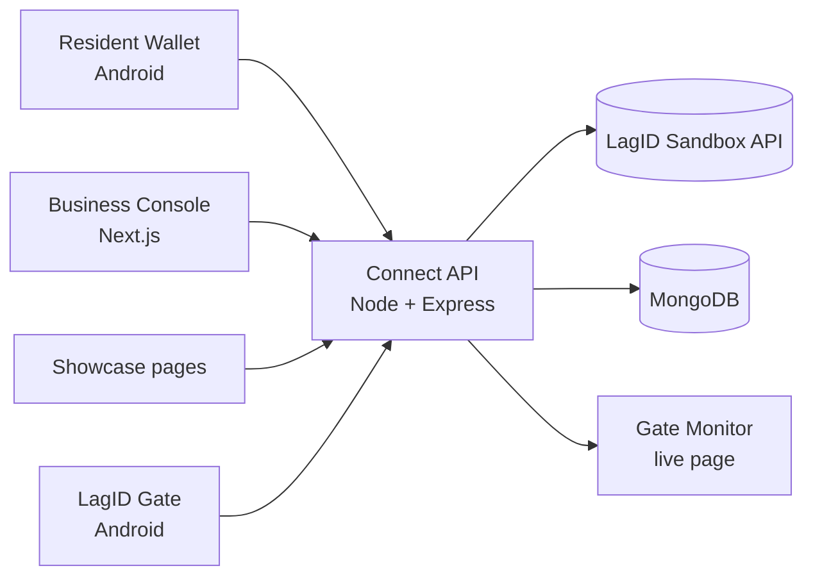

# LagID Connect

**Verify with LagID: one button for every landlord, estate, employer
and event in Lagos, with the resident in control.**

Built for the Identiko LagID Hackathon 2026 by Adebayo Jamiu.

Today, proving who you are in Lagos usually means handing over a
photocopy of your ID. It's easy to fake, it shares far more than the
other side needs, and you never find out who checked you or why.

LagID Connect replaces the photocopy. A business asks for the facts it
needs, such as "verified Lagos resident" and "name matches". The resident
sees the request on their phone, picks what to share and approves it.
The business then gets a signed yes or no answer, checked against the
LagID registry at that moment, and never a copy of the record. In person,
the resident shows a wave-locked pass that can't be screenshotted or
replayed, and the gate matches their face live.

## Live

| What | Where |
| --- | --- |
| Connect API | https://lagid-connect-api.onrender.com |
| Business Console | https://lagid-connect.vercel.app |
| Tenancy showcase | https://lagid-connect.vercel.app/showcase/ikeja-heights |
| Gate Monitor | https://lagid-connect-api.onrender.com/gate |
| Android apps | See Releases (LagID Wallet, LagID Gate) |

The API runs on Render's free plan, so the first request after a quiet
spell can take up to a minute while it wakes up.

## How the LagID Sandbox API is used

The sandbox sits at the centre of every flow. If it goes down, residents
can't link, approve or get a gate pass.

| Feature | Sandbox endpoint | Why |
| --- | --- | --- |
| Linking a wallet | `GET /api/v1/identity/lag/{lagId}` | The record must exist and be verified, and the phone number must match it |
| Every approval | `GET /api/v1/identity/lag/{lagId}` | Claims come from a fresh lookup, never from stored data |
| Every gate pass | `GET /api/v1/identity/lag/{lagId}` | Fresh check before each 30-second pass is issued |
| Batch verification | `POST /api/v1/identity/lag/batch` | HR or a landlord checks up to 100 LagIDs at once |
| Demo residents | `GET /api/v1/identity/verify` | Paged list of sample records for testing |

Only the Connect API holds the sandbox key. Phones and browsers never
see it.

## What's in the box



| Folder | What it is |
| --- | --- |
| `api/` | Connect API: consent requests, ES256-signed claims, gate passes, batch checks, audit log, webhooks, Gate Monitor |
| `wallet-android/` | Resident Wallet: link a LagID, approve or decline, activity log, remove access, wave-locked gate pass |
| `verifier-android/` | LagID Gate: scans the pass, checks it, runs a live face match, shows GRANTED or DENIED |
| `console/` | Business Console: dashboard, verify a resident, batch verification, audit log, developer docs, tenancy showcase |

## The flows

**1. Link.** The resident enters their LagID and phone number. The API
looks the record up in the sandbox and checks the phone, then sends a
one-time code. The sandbox can't send SMS, so in demo mode the code shows
in the app. A live face check follows: blink, turn your head, look
straight. That produces a face template which stays on the phone. The
phone also creates its own P-256 key in the Android Keystore.

**2. Consent.** A business calls `POST /v1/requests` with the LagID,
the claims it wants and a purpose. The resident sees who is asking and
why, with a switch for each claim, and approves with a signature from
the device key. The API then does a fresh sandbox lookup, works out the
answers and signs them:

```json
{
  "purpose": "Tenancy application, Flat 4B",
  "claims": { "lagos_resident": true, "name_match": true, "age_over_18": true },
  "aud": "biz_6b05b0b87877a3d51632e7cb",
  "sub": "res_ldXkSn5NB_0xqVTf0HoI4C"
}
```

Anyone can check the signature with the public keys at
`/.well-known/jwks.json`.

**3. In person.** The wallet shows a single-use pass code as a moving,
wave-locked QR. The gate's scanner has to watch the wave move for about
two seconds, so a photo or screenshot fails. The code works once, for 30
seconds. The gate then runs a live face check and compares the face with
the template the resident enrolled. The result appears on the gate phone
and on the Gate Monitor.

**4. Control.** Every check appears in the resident's activity log, and
they can remove a business's access at any time.

**5. Batch.** The console checks up to 100 LagIDs from a CSV through the
sandbox's batch lookup and returns found, verified, name match and over
18 for each one. Nothing else comes back.

## Privacy and security

- **Least data.** Businesses get yes or no answers unless the resident
  agrees to share more. The NIN, phone, address and LASRRA ID are never
  passed on.
- **No tracking across businesses.** Each business sees a different
  subject ID for the same resident.
- **Little stored.** LagIDs are kept as salted hashes. The face template
  stays on the phone, and the server keeps only its SHA-256. A copy
  travels with a gate pass for 30 seconds and is deleted once the gate
  reports back.
- **Every approval is signed** by the resident's device key, and every
  answer is signed by the Connect API with ES256.

| Threat | Answer |
| --- | --- |
| Screenshot or photo of the pass | The wave lock: no single frame can be read |
| Screen recording replayed | Single-use code that lasts 30 seconds, plus the live face match |
| Someone else holding the phone | Live face match against the enrolled template |
| A business asking for too much | Claims shown one by one, purpose required and logged |
| Changing an approval after signing | Refused: the device signature covers the exact claims |
| Forged answer | ES256 signature checked against the public keys |

Choices like these line up with the consent and data-minimisation duties
in Nigeria's Data Protection Act 2023. This is a hackathon build, not a
compliance claim.

## Known limits

- **One-time codes** show on screen because the sandbox has no SMS.
- **Face matching** compares against the selfie enrolled at linking. The
  sandbox's `image_url` values point to a domain that doesn't resolve, so
  the LagID photo can't be used yet. Once photos load, linking can
  compare the selfie with the registry photo.
- **The gate needs a network connection.** The wave QR holds 84
  characters, which is too small for a signed credential, so the pass is
  a short server-issued code.
- **The face model** is MobileFaceNet at a starting threshold of 0.55.
  It's demo-grade, not certified.

## Run it locally

You need Node.js 20+, a MongoDB Atlas database, a LagID sandbox team key
and Android Studio Ladybug or newer.

```bash
# API
cd api
npm install
cp .env.example .env      # fill in MONGODB_URI and SANDBOX_API_KEY
npm run keys              # paste the two lines into .env
npm run dev               # http://localhost:4000
npm run seed              # demo businesses
npm run demo              # end-to-end checks (40)

# Console
cd console
npm install
cp .env.example .env.local
npm run dev               # http://localhost:3000
```

Get a business key with `npm run key` in `api/`. For the Android apps,
put `lagid.apiUrl=...` in each app's `local.properties`, and for the gate
app add `lagid.gateKey=...` too. Each folder has its own README.

## Built with

Node.js, Express, MongoDB, `jose` (ES256), Next.js, Kotlin, Jetpack
Compose, CameraX, ML Kit face detection, TensorFlow Lite (MobileFaceNet),
ZXing, the FaceMatch engine and the WaveLockedQR library.
